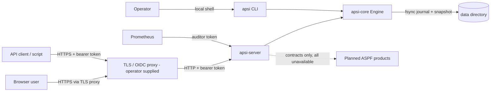

# Threat model

This extends [docs/SECURITY.md](../docs/SECURITY.md), which lists the implemented controls together with the tests that evidence them. This document adds data classification, the boundaries to the planned products, and the incident path.

## System context

## Trust boundaries

| # | Boundary | Crossing | Controls |
|---|---|---|---|
| B1 | Internet to proxy | TLS | TLS is terminated by the operator's proxy; `apsi-server` does not terminate TLS |
| B2 | Proxy to API | bearer token | hashed tokens, tenant taken from the token, role matrix, rate limit, 16 MiB body limit, security headers |
| B3 | API to engine | `Principal` | `authorize` checks the tenant before the role; other tenants' records return `not_found` |
| B4 | Engine to disk | file I/O | single writer, fsync per commit, atomic snapshot, hash-chained audit verified on open |
| B5 | Operator to CLI | filesystem access | an operator with access to the data directory is fully trusted |
| B6 | APSInsight to ASPF products | `apsi-contracts` ports | requests validated before any provider call; default adapters unavailable; device commands need an interlock, an acknowledgement and an expiry |

## Data classification

| Class | Examples | Handling |
|---|---|---|
| Secret | API tokens, future provider credentials | never stored in clear (SHA-256 only); never logged (`metrics::redact`); never committed; injected through environment or secret references |
| Confidential (tenant) | records, attributes, history, exports | tenant-isolated; exported only by authorised roles; audit records ids, never contents |
| Internal | schemas, rules, workflows, metrics | readable by tenant roles; metrics labels contain slugs and codes only |
| Public | feature register, catalogue, documentation, contracts | no restriction |

Records may contain personal data about farmers or workers. Use the minimum attributes needed, delete with `DELETE` (archived records only, and not under legal hold) and use `legal_hold` for preservation. Anonymisation and pseudonymisation are **not implemented** (see STATUS, privacy domain).

## Threats (STRIDE) beyond docs/SECURITY.md

| Threat | Boundary | Control | Status |
|---|---|---|---|
| Spoofing a planned product or device | B6 | No adapter is reachable; a future adapter must pass `conformance::check_*` and match a compatible contract version | implemented and tested |
| Unsafe actuator command (tampering or elevation) | B6 | `CommandSafetyEnvelope::validate_for`: declared actuator, acknowledgement, interlocks, at most 1 h duration, at most 900 s validity | implemented and tested |
| AI output presented as fact (repudiation, integrity) | B6 | the KutajKutambi contract has no `observation` kind, requires model, evaluation and uncertainty, cites only supplied evidence, and requires approval for recommendations | implemented and tested |
| Accelerator returns wrong numbers | B6 | results compared with `CpuFallback` within the job tolerance | implemented and tested |
| Supply-chain compromise | build | lockfiles; `cargo deny`; `npm audit`; SBOM; secret scan in CI | defined in CI, not run in this environment |
| Token replay after leak | B2 | static tokens, rotated by restart; no revocation list | residual risk |
| Multi-replica rate-limit bypass | B2 | per-process limiter | residual risk |

## Incident response

See the [incident response runbook](../20_backend_observability/runbooks/incident-response.md). Vulnerability reports follow [SECURITY.md](../SECURITY.md).
