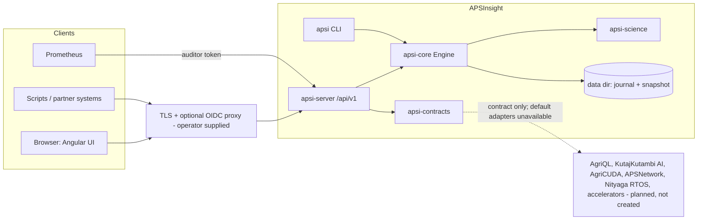
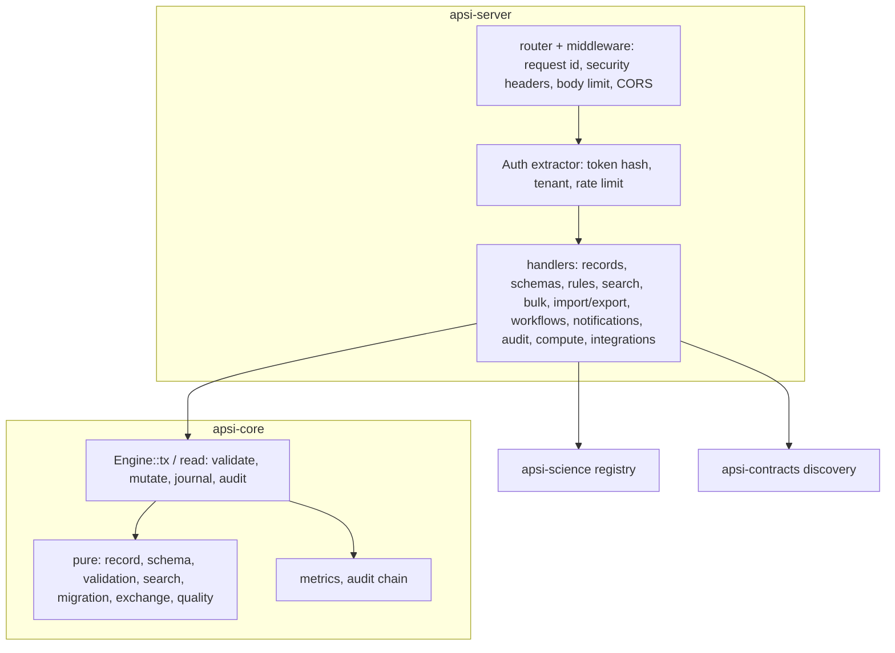

# Architecture

## The register is a product, so the code is too

`register/APSInsight_Feature_Register.json` holds 3,100 features. `tools/analyse-register.mjs` proves they are exactly **100 domains × 31 capabilities**: every requirement is a capability template with the domain's entity list substituted. The domains define **800 entity kinds** (most have 8; two have 7 and two have 9).

So APSInsight implements each capability **once**, generically, and applies it to every entity kind listed in `register/catalog.json`:

```
register/            feature register + derived catalogue (100 domains, 31 capabilities, 800 entity kinds)
crates/apsi-core     engine: records, schemas, validation, search, bulk, versioning, provenance,
                     quality, retention, notifications, workflows, migrations, audit, metrics,
                     traceability, generated docs
crates/apsi-science  domain computations (indices, geo, statistics, time series, agronomy,
                     hydrology, economics, carbon) exposed as a JSON compute registry
crates/apsi-server   HTTP API /api/v1 (axum) + serves the built UI
crates/apsi-contracts versioned contracts for planned ASPF products (no product code)
crates/apsi-cli      `apsi` command line
web/                 Angular 22 UI (zoneless, signals)
docs/                this documentation; docs/domains/*, traceability.csv, STATUS.md, UNITS.md are generated
01_ … 72_            the 72 canonical directories: ownership, purpose, coverage and gaps (generated READMEs)
```

The canonical directories own areas of the system and point to the code; the code stays where Cargo and Angular expect it. Each README shows the honest status of the features it owns ([01_governance/structure.json](../01_governance/structure.json), checked by `tools/structure.mjs --check`).

## Records

Every entity kind stores **records** with the same envelope: `id` (`rec_<uuidv7>`, time-ordered and opaque), `tenant`, `domain`, `entity`, `schema_version`, `version`, `lifecycle`, `name`, `attributes` (JSON object), `tags`, `source {system, id}`, `owner`, `legal_hold`, timestamps, actors and `provenance[]`.

The **source identity** (`source.system`, `source.id`) is unique per tenant and entity kind. Re-importing the same source record therefore conflicts, or upserts with `upsert: true`, and never duplicates.

## Metadata

Units belong to schema fields (`unit`, UCUM-style codes) and to the record's `unit` attribute. Ownership, creation and update actors and timestamps are always present. Schemas may declare `min`/`max`/`max_length` and enumerations.

## Lifecycle

`draft → active → archived`, plus `draft → archived`. Restoring `archived → active` needs the admin role. Archived records are read-only. Permanent deletion is only possible for archived records that are not under legal hold.

## Versioning

Every accepted change increments `version` and appends a full `RecordVersion` snapshot. Versions can be diffed field by field and rolled back. A rollback is a new version, so history is never rewritten. Rollback across a schema migration is refused; roll back the migration instead.

## Provenance

Each change appends a `ProvenanceEvent` with the actor, actor kind (user or service), action, source reference, transformation description and input record ids. In addition, every operation, including denials and failures, appends to a **hash-chained audit log** (SHA-256 over each event plus the previous hash). The chain is verified on every open, so tampering is detected.

## Concurrency

All mutations run under one write lock as transactions, and every operation **validates before it mutates**, so a failed operation leaves no trace beyond its audit event. Lost updates are prevented by optimistic concurrency: updates carry `expected_version` (HTTP `If-Match`), and stale writes get a retryable `version_conflict`. The test `concurrent_writers_never_lose_updates` runs 8 threads × 25 increments and expects exactly 200.

## Persistence

`Engine::open(dir)` uses two files:

- `journal.ndjson`: one fsynced line per committed transaction, containing only what changed (record upserts and deletes, metadata when dirty, new audit events).
- `state.json`: a snapshot, rewritten atomically (temp file + rename) every 2,000 commits, after which the journal is truncated.

On open, the journal is replayed over the snapshot. Replay is idempotent: upserts are whole records, and audit events are deduplicated by sequence number. A torn final line (a crash mid-write, never acknowledged) is ignored; any other corruption is an error. If a journal write fails, memory is reloaded from disk and the caller gets a retryable `storage_unavailable`.

## Quality

See `crates/apsi-core/src/quality.rs` for the documented formulas (completeness, validity, freshness, provenance coverage), missing-data behaviour (an empty collection gives `null`, never 0 or 1) and limitations.

## Retention

Per entity kind, `archive_after_days` (time since last update) and `purge_archived_after_days` (time since archival) apply. Legal hold blocks both, and blocks manual deletion. Every run can be previewed with `dry_run`.

## Workflows

A workflow is an ordered list of typed steps: `search → RecordSet`, `quality → QualityReport`, `extract_numbers(RecordSet) → Json`, `compute(Json) → Json`. References and types are checked when the workflow is registered. Each run records a definition hash and a **data fingerprint** (a hash over every record id and version it read). The same definition and fingerprint means the same outputs; freshness, which depends on wall-clock time, is excluded from outputs.

## Migrations

A migration plan has a `to_version` and ordered operations: `rename`, `set_default`, `remove`, `scale` (unit conversion) and `set_unit`. A dry run validates every affected record against the target schema. Applying is all-or-nothing: any failure means nothing changes. Rollback restores each record's pre-migration version, unless the record was edited afterwards; those are reported as conflicts and left alone.

## Context



## Containers and components



## Data flow of a write

1. The proxy terminates TLS and forwards the bearer token.
2. `Auth` hashes the token, resolves the principal (whose tenant is fixed by the token) and applies the rate limit. Rejections are counted in the `http.auth` metric.
3. The handler decodes the body (≤ 16 MiB) into typed values; malformed input becomes `invalid_input`.
4. `Engine::tx` authorises (tenant before role) and validates against the schema and rules. It then mutates, appends provenance and history, updates indexes and evaluates notification rules.
5. The change is appended to the journal and fsynced, and the hash-chained audit event is written. Only then is the response sent.

## Trust boundaries

B1 internet → proxy, B2 proxy → API, B3 API → engine, B4 engine → disk, B5 operator → CLI, B6 APSInsight → ASPF products. The controls and evidence for each are in the [threat model](../01_governance/threat-model.md) and [SECURITY.md](SECURITY.md).

## Language boundaries

Rust for every backend crate and TypeScript for the UI. There is no C++, Python, Haskell or Idris, because no benchmark has justified any of them yet. The C ABI rules a future kernel must follow are in [ADR-0006](../01_governance/adr/0006-language-boundaries.md).

## Units and CRS

`apsi_science::units::Quantity` rejects dimensionally invalid operations ([docs/UNITS.md](UNITS.md), [ADR-0008](../01_governance/adr/0008-units-and-crs.md)). Geometry is WGS 84 lon/lat unless a CRS is declared ([CRS policy](../03_domain_model/crs-policy.md)).

## Integration contracts

Planned ASPF products are reached only through `apsi-contracts` ports. Each has a versioned wire contract, capability discovery and a conformance harness. The default adapter reports the product unavailable, and nothing depends on the product being present ([ADR-0005](../01_governance/adr/0005-future-aspf-products-as-contracts.md), [contract specs](../70_connectors_external/aspf-contracts/README.md)).
