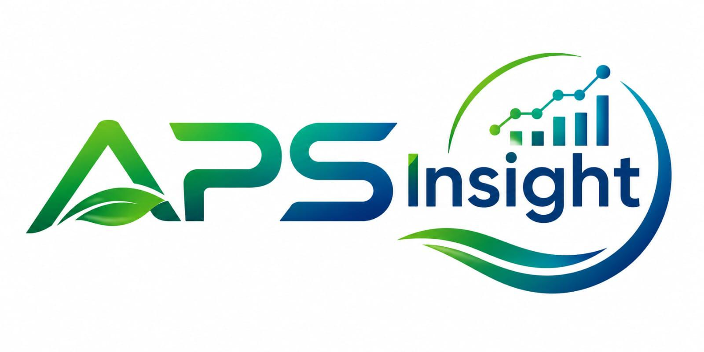

# APSInsight

  

**Agricultural Data Analytics, Scientific Computing, Research and Intelligence Platform**

Organization: Agriculture Service of Product Farm (ASPF)

## Overview

APSInsight is a polyglot, modular, API-first platform for agricultural data analytics, scientific computing, geospatial intelligence, research analytics, sensor fusion, and evidence-based decision support.

## Technology Stack

| Component | Technology |
|-----------|------------|
| Frontend | TypeScript, React, Vite |
| Application Backend | Ruby on Rails |
| Scientific Computing | C++20/23 |
| Scientific Data Processing | Python |
| Statistical Research | R |
| Application Database | PostgreSQL |
| Analytical Query Engine | DuckDB |
| Analytical Storage | Parquet / GeoParquet |
| Geospatial | GDAL, PROJ |
| Authentication | OpenID Connect / Keycloak |
| Deployment | Docker / Docker Compose |

## Architecture Principles

- Ruby on Rails is the primary application backend.
- C++ provides the native high-performance computing engine.
- Python serves as the principal scientific processing and ML layer.
- R is an optional statistical runtime.
- No duplicate backends (do not build a competing FastAPI service).

## Getting Started

See `docs/developer-guide/` and `compose.yaml` for local development setup.

## Implementation Status

See `IMPLEMENTATION_STATUS.md` for current progress across all components.